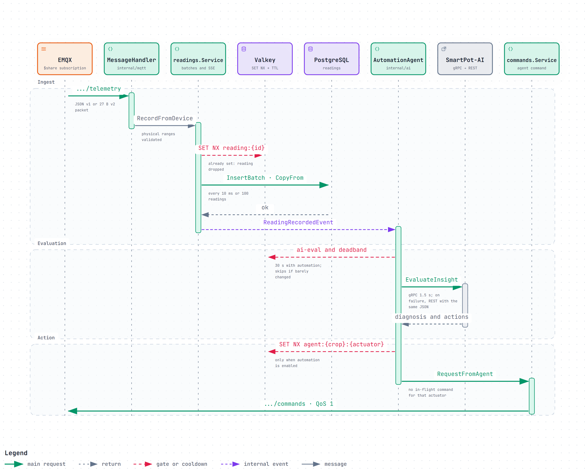
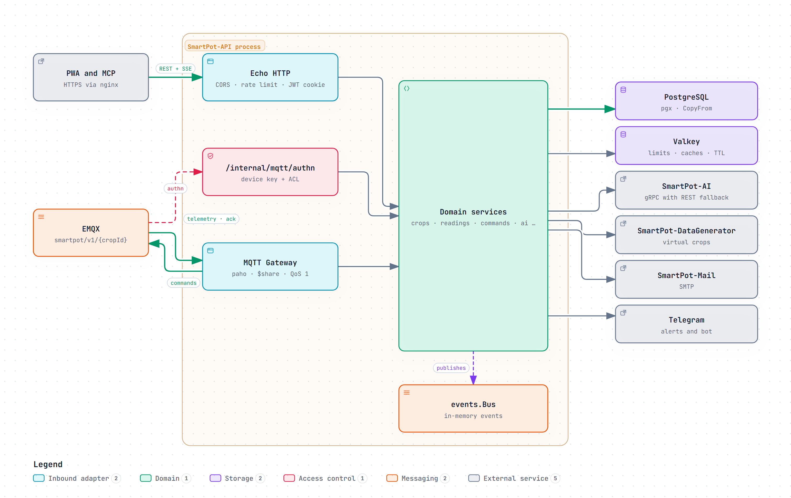
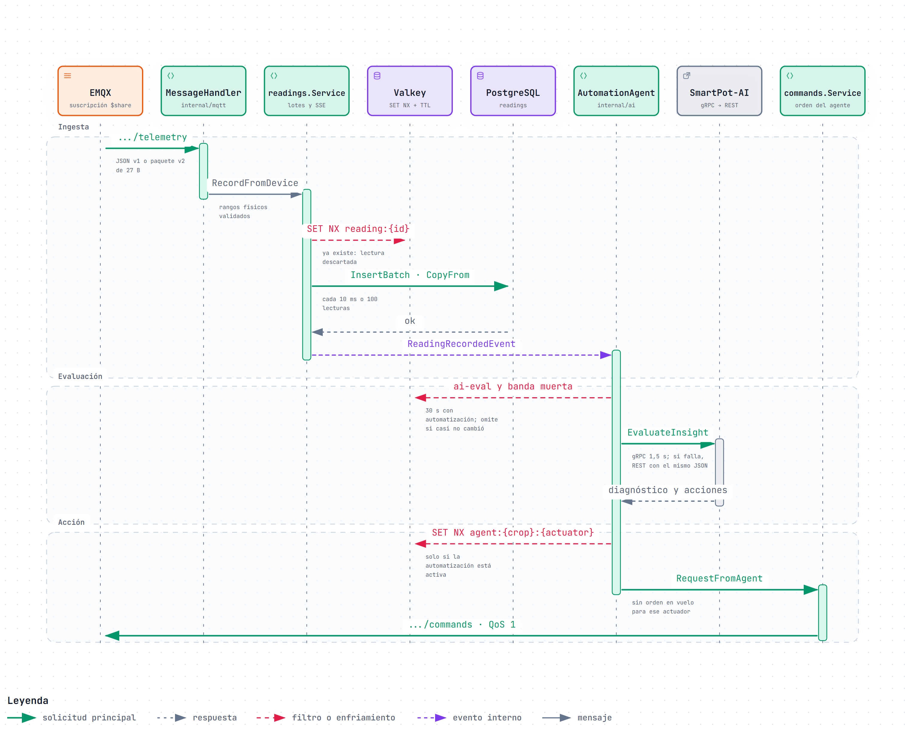

# SmartPot-API · Interactive Diagrams

[English](#english) | [Español](#español)

---

## English

Each diagram is a self-contained HTML page that works offline. Download it and open it in a browser to zoom, search nodes, trace a path and jump to the exact source lines on GitHub. The PNG preview is the light-theme render of the same diagram.

### 1. From Telemetry to an Agent Command

One reading from the broker to the actuator. `MessageHandler` parses JSON v1 or the 27-byte v2 packet, `readings.Service` drops out-of-range values and anything faster than the per-crop `SET NX` gate in Valkey, and the batch worker stores readings with `CopyFrom` every 10 ms or 100 readings before publishing `ReadingRecordedEvent`. `AutomationAgent` skips the evaluation when the cooldown or the deadband says nothing changed, asks SmartPot-AI over gRPC (1.5 s, then REST with the same JSON) and, only when automation is on and the actuator cooldown is free, `commands.Service` publishes the command with QoS 1.

- Interactive: [English](SmartPot_API_A1_Telemetry_To_Command_Sequence.en.html) · [Spanish](SmartPot_API_A1_Telemetry_To_Command_Sequence.es.html)
- Sources: `internal/mqtt/`, `internal/readings/service.go`, `internal/storage/postgres/readings.go`, `internal/cache/valkey/valkey.go`, `internal/ai/agent.go`, `internal/ai/client.go`, `internal/ai/resilience.go`, `internal/commands/service.go` and `cmd/api/main.go` at commit `b4125e7`.

### 2. SmartPot-API: Ports and Adapters

The hexagonal layout wired in `cmd/api/main.go`. Inbound adapters are the Echo HTTP server (CORS, rate limit and JWT cookie guard for the PWA and MCP), the `/internal/mqtt/authn` endpoint that EMQX calls before any rate limit, and the MQTT gateway with its shared subscription and QoS 1 commands. The domain services publish in-memory events on `events.Bus` and reach every outside system through a port: PostgreSQL with pgx, Valkey, SmartPot-AI over gRPC with REST fallback, SmartPot-DataGenerator, SmartPot-Mail over SMTP and Telegram.

- Interactive: [English](SmartPot_API_A2_Ports_And_Adapters.en.html) · [Spanish](SmartPot_API_A2_Ports_And_Adapters.es.html)
- Sources: `cmd/api/main.go`, `internal/httpserver/server.go`, `internal/mqtt/`, `internal/platform/events/events.go`, `internal/storage/postgres/postgres.go`, `internal/cache/valkey/valkey.go`, `internal/ai/client.go`, `internal/virtualdevices/client.go`, `internal/mail/mail.go` and `internal/channels/telegram/client.go` at commit `b4125e7`.

---

## Español

Cada diagrama es una página HTML autocontenida que funciona sin conexión. Descárgala y ábrela en un navegador para ampliar, buscar nodos, seguir un recorrido y saltar a las líneas exactas del código en GitHub. La vista previa PNG es el mismo diagrama en tema claro.

### 1. De la telemetría a la orden del agente

Una lectura desde el broker hasta el actuador. `MessageHandler` interpreta JSON v1 o el paquete v2 de 27 bytes, `readings.Service` descarta valores fuera de rango y todo lo que llegue antes que la compuerta `SET NX` por cultivo en Valkey, y el worker de lotes guarda las lecturas con `CopyFrom` cada 10 ms o 100 lecturas antes de publicar `ReadingRecordedEvent`. `AutomationAgent` omite la evaluación cuando el enfriamiento o la banda muerta indican que nada cambió, consulta SmartPot-AI por gRPC (1,5 s y después REST con el mismo JSON) y, solo si la automatización está activa y el enfriamiento del actuador está libre, `commands.Service` publica la orden con QoS 1.

- Interactivo: [inglés](SmartPot_API_A1_Telemetry_To_Command_Sequence.en.html) · [español](SmartPot_API_A1_Telemetry_To_Command_Sequence.es.html)
- Fuentes: `internal/mqtt/`, `internal/readings/service.go`, `internal/storage/postgres/readings.go`, `internal/cache/valkey/valkey.go`, `internal/ai/agent.go`, `internal/ai/client.go`, `internal/ai/resilience.go`, `internal/commands/service.go` y `cmd/api/main.go` en el commit `b4125e7`.

### 2. SmartPot-API: puertos y adaptadores

La disposición hexagonal que arma `cmd/api/main.go`. Los adaptadores de entrada son el servidor HTTP Echo (CORS, límite de tasa y guardia de la cookie JWT para la PWA y MCP), el endpoint `/internal/mqtt/authn` que EMQX llama antes de cualquier límite y el gateway MQTT con su suscripción compartida y los comandos QoS 1. Los servicios de dominio publican eventos en memoria en `events.Bus` y llegan a cada sistema externo por un puerto: PostgreSQL con pgx, Valkey, SmartPot-AI por gRPC con respaldo REST, SmartPot-DataGenerator, SmartPot-Mail por SMTP y Telegram.

- Interactivo: [inglés](SmartPot_API_A2_Ports_And_Adapters.en.html) · [español](SmartPot_API_A2_Ports_And_Adapters.es.html)
- Fuentes: `cmd/api/main.go`, `internal/httpserver/server.go`, `internal/mqtt/`, `internal/platform/events/events.go`, `internal/storage/postgres/postgres.go`, `internal/cache/valkey/valkey.go`, `internal/ai/client.go`, `internal/virtualdevices/client.go`, `internal/mail/mail.go` y `internal/channels/telegram/client.go` en el commit `b4125e7`.

